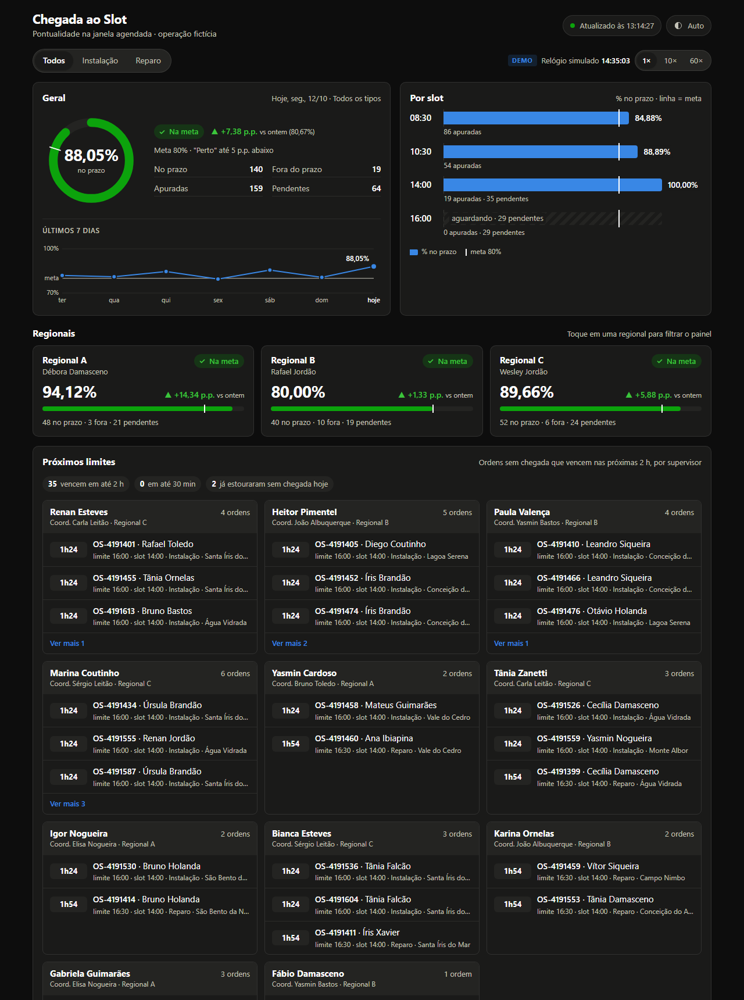
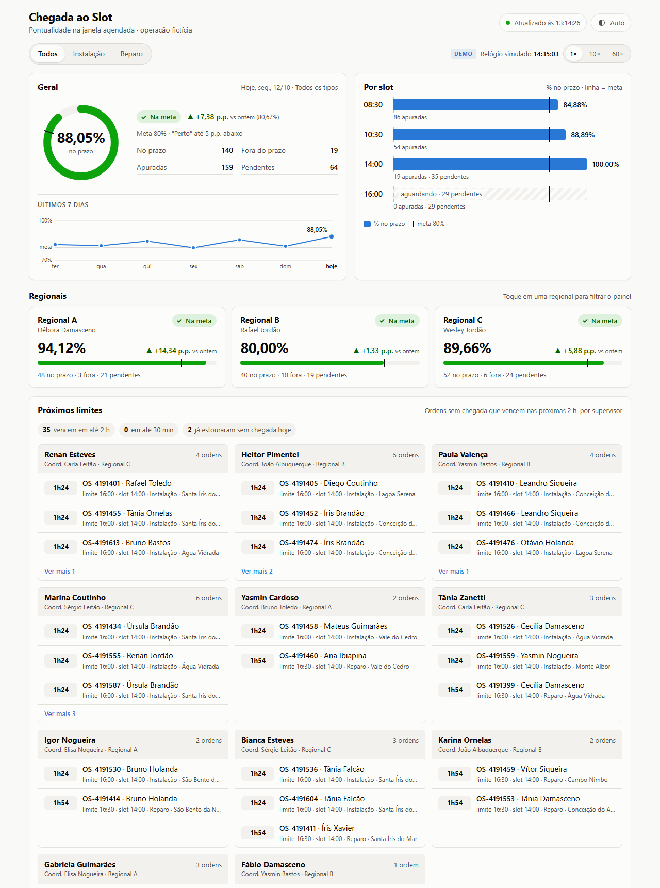
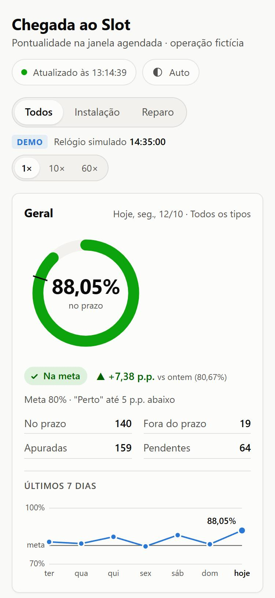
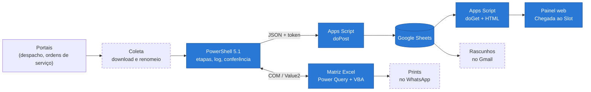

# field-ops-automation

[](https://github.com/lucas-amorim-devpro/field-ops-automation/actions/workflows/tests.yml)


Automação de relatórios operacionais de uma operação de campo (instalação e reparo de fibra):
**PowerShell orquestrando Excel via COM (Power Query + VBA), envio para Google Sheets via Apps Script
e um painel web de pontualidade.**

### ▶ [Abrir o painel de demonstração](https://lucas-amorim-devpro.github.io/field-ops-automation/)

[](https://lucas-amorim-devpro.github.io/field-ops-automation/)

<details>
<summary>Tema claro e celular</summary>

 

</details>

> **Este repositório é uma demonstração.** Todo o código foi **reescrito do zero** a partir da minha
> experiência no trabalho, com **dados 100% fictícios** gerados por script. Não há nome de empresa,
> pessoas, cidades reais, sistemas internos, IDs de planilha, URLs de implantação, caminhos de rede
> nem senhas. Os números de "Resultados" abaixo são da operação real; os números exibidos no painel
> são da massa de dados fictícia.

---

## O problema

Operação de telecom com **3 contratos regionais**. Todo dia, a equipe de planejamento precisava
baixar exportações de vários portais, tratar no Excel, calcular indicadores e distribuir os
resultados para gerentes, coordenadores e supervisores. Eram **18 relatórios diários** e cerca de
**10 semanais/mensais**, feitos à mão, com copiar e colar, sujeitos a erro e a atraso.

Um dos indicadores mais acompanhados é a **"Chegada ao Slot"**: o técnico chegou ao cliente dentro
da janela agendada (08:30, 10:30, 14:00 ou 16:00)? A meta é 80%, e a gestão quer acompanhar ao
longo do dia, não só no fechamento.

## A solução

Uma biblioteca de scripts **PowerShell** que, para cada relatório:

1. abre a **matriz Excel** via COM, numa instância isolada e invisível;
2. aponta e atualiza as consultas **Power Query** que tratam as exportações;
3. roda a **macro VBA** que calcula os indicadores (sem área de transferência);
4. lê o resultado de uma vez (`Value2`) e **confere** com um cálculo independente;
5. envia os valores em JSON para um **Web App do Google Apps Script** (`doPost` com token);
6. entrega por **4 canais**: painel web, Google Sheets, rascunhos no Gmail e prints no WhatsApp.

Cada etapa é registrada em log com duração e erro, o Excel é sempre encerrado (mesmo quando algo
falha) e o mesmo script roda no PC de qualquer pessoa da equipe.

## Resultados (na operação real)

| | Antes | Depois |
|---|---|---|
| Rotina diária de relatórios | ~3 h | **~1 h 50** |
| Relatórios automatizados | — | **18 diários + ~10 semanais/mensais** |
| Quem usa | — | **toda a equipe (4 pessoas)** |
| Abertura do painel de pontualidade | ~18 s | **~2 s** |
| JSON do painel | 660 KB | **265 KB** (dicionário + linhas) |

O painel ficou rápido com três medidas: dados embutidos no HTML na primeira carga, JSON compactado
(cada texto aparece uma vez num dicionário; as linhas guardam só índices) e cache dividido em
pedaços (o `CacheService` aceita até 100 KB por chave). Na massa fictícia deste repositório, a
mesma técnica reduz o JSON de 454 KB para 47 KB, porque a hierarquia fictícia é fixa e cabe
inteira no dicionário.

## Arquitetura



Em azul, o que está implementado neste repositório. Com borda tracejada, o que existe na operação
real e está no [Roadmap](#roadmap).

## O que tem aqui

| Pasta | Conteúdo |
|---|---|
| [`data-sample/`](data-sample) | Gerador de ordens de serviço fictícias com "sujeira" realista (espaços, datas em 6 formatos, serial do Excel, acentuação quebrada, duplicadas) e exportador para o JSON compactado do painel |
| [`dashboard-pages/`](dashboard-pages) | **Vitrine:** painel estático (HTML/CSS/JS, sem dependências) publicado no GitHub Pages. Rosca vs meta, selo Na meta / Perto / Abaixo, variação em p.p., barras por slot, regionais, "Próximos limites" com contagem regressiva, hierarquia gerente → técnico, Instalação/Reparo, tema claro/escuro, celular |
| [`excel-pipeline/`](excel-pipeline) | Pipeline PowerShell → Excel (COM) → Apps Script, a consulta Power Query (`.pq`), o módulo VBA exportado (`.bas`), o script que monta a matriz `.xlsm` e o `config.example.json` |
| [`excel-pipeline/lib/`](excel-pipeline/lib) | Funções comuns: log por etapa, QuickEdit, datas em vários formatos, limpeza de texto, indicador, Excel COM, JSON compacto, envio ao Apps Script |
| [`apps-script/`](apps-script) | `ingest-webapp` (doPost com token → Sheets) e `slot-dashboard` (doGet com a mesma interface do painel, lendo do Sheets, com cache em pedaços) |
| [`tests/`](tests) | Testes Pester (tratamento, datas, indicador, Excel real, pipeline de ponta a ponta) |
| [`tools/`](tools) | Servidor HTTP local em PowerShell, conversor para UTF-8 com BOM e o build dos HTMLs do Apps Script |

### Uma regra, três linguagens, os mesmos números

O indicador é calculado em **VBA** (na matriz), **PowerShell** (conferência no pipeline) e
**JavaScript** (painel). As três implementações seguem a mesma regra e são testadas com os mesmos
casos:

- janela de 2 h a partir do slot; Reparo tem 30 min de tolerância;
- sem chegada e com o limite vencido conta como fora do prazo; ainda dentro do prazo conta como pendente;
- percentual com 2 casas e arredondamento **meio para cima**, igual ao `ARRED` do Google Sheets
  (o `Round` do VBA e o `[math]::Round` do .NET usam arredondamento bancário: `0,125 → 0,12`).

O pipeline recusa o envio se Excel e PowerShell divergirem em qualquer grupo.

## Como rodar

Requisitos: Windows, PowerShell 5.1 ou 7, Excel 365 (para a parte do Excel) e
[Pester 5+](https://pester.dev) para os testes.

```powershell
# 1. Dados fictícios (7 dias, ~240 ordens/dia) e JSON do painel
.\data-sample\New-FakeServiceOrders.ps1 -ReferenceDate (Get-Date).Date
.\data-sample\Export-DashboardData.ps1

# 2. Painel local em http://localhost:8080
.\tools\Start-DashboardServer.ps1

# 3. Testes (o -SkipExcel pula os que abrem o Excel)
Install-Module Pester -Scope CurrentUser -Force -SkipPublisherCheck
.\tests\Invoke-Tests.ps1

# 4. Matriz Excel de demonstração e pipeline completo sem enviar nada
.\excel-pipeline\Build-DemoWorkbook.ps1
.\excel-pipeline\Invoke-SlotPipeline.ps1 -DryRun
```

O `Build-DemoWorkbook.ps1` importa o módulo VBA por script e, para isso, precisa da opção do Excel
*Confiar no acesso ao modelo de objeto do projeto do VBA* (Central de Confiabilidade >
Configurações de Macro). Não é preciso "Habilitar todas as macros".

Para enviar de verdade, copie `excel-pipeline/config.example.json` para `config.json` (que está no
`.gitignore`) e preencha a URL `/exec` e o token do Web App. O passo a passo de implantação do Apps
Script está em [`docs/prompt-claude-web-apps-script.md`](docs/prompt-claude-web-apps-script.md).

## Aprendizados

Problemas reais que resolvi ao longo do projeto original:

| Problema | Solução |
|---|---|
| **COM do Excel "perde o tipo" em `Value2`.** Depois de gravar texto numa variável COM, gravar número falhava com `InvalidCastException` | Gravar via `InvokeMember('Value2', SetProperty, …)`, que passa direto pelo IDispatch. O HResult real fica na `InnerException` |
| **Data depende do Windows de quem roda.** Num PC o formato era `d/M/yy`; em outro, `dd/MM/yyyy` | Nunca converter data por texto com a cultura atual: `ParseExact` com a lista de formatos e cultura invariante, ou o serial do `Value2` |
| **Macro usando a área de transferência.** `Select`/`Copy`/`Paste` impediam o usuário de usar o PC durante o relatório | Copiar valores direto (`.Value2 = .Value2`) e trabalhar com arrays. Resultado validado idêntico ao da versão antiga |
| **`SpecialCells` falha via `Application.Run`.** Chamada de fora, a macro não encontrava as células visíveis | `SUBTOTAL(103, …)` para contar visíveis funciona em qualquer contexto |
| **Constante errada de `PasteSpecial`.** `-4163` é `xlPasteValues`; `-4104` é `xlPasteAll`. A troca apagou a formatação condicional de dias inteiros | Constantes nomeadas e cópia por valor, sem `PasteSpecial` |
| **Ordenar arquivos pelo nome.** CSVs nomeados `dd.MM` pegavam agosto antes de outubro | Ordenar pela data de modificação e validar a data que está dentro do arquivo |
| **Clique no console congela o script.** Com o QuickEdit, um clique seleciona texto e pausa a execução | `Disable-QuickEdit` (API `SetConsoleMode`) no início dos scripts longos |
| **Acentos quebrados no PowerShell 5.1.** Arquivo sem BOM é lido como ANSI | Scripts em UTF-8 **com BOM**; há um teste que falha se algum `.ps1` estiver sem |
| **Aba em segundo plano congela o painel.** O navegador desacelera ou pausa `setInterval` | Recalcular e consultar a versão no `visibilitychange`, com indicador visual de atualização |
| **Iframe do Google Sites.** O iframe tem a altura da página, e `position: fixed` abria a gaveta de detalhe no topo | Detectar o quadro alto e posicionar pelo ponto do clique / área visível |
| **Painel diferente da planilha.** A equipe confere o painel contra o Sheets, e 2 casas com arredondamento diferente não batiam | Arredondamento "meio para cima" (como o `ARRED`), implementado e testado em VBA, PowerShell e JS |

E problemas que apareceram ao **reescrever este repositório**, todos pegos por testes:

| Problema | Solução |
|---|---|
| Passar um valor como parâmetro de função ao `InvokeMember` gerava `0x800A03EC`: o PowerShell embrulha o valor em `PSObject` | Desembrulhar (`$v.psobject.BaseObject`) antes de chamar o COM |
| Função que devolve o `object[,]` do `Value2` entregava uma lista "desenrolada" | `return ,$valor` (a vírgula impede o pipeline de enumerar) |
| No Power Query, "NÃO" e "SÃO" em maiúsculas têm um "Ã" legítimo, e o reparo de acentos os transformava em "N�O" sem gerar erro. Uma ordem sumia | Descartar o reparo quando o resultado contém `�` (U+FFFD). Pego pela conferência Excel × PowerShell |
| O Excel converte o texto `"08:30"` em hora ao gravar, e a chave do grupo deixava de bater | Formatar a coluna como texto (`@`) antes de gravar (o Google Sheets faz o mesmo) |
| O editor VBA só importa `.bas` em ANSI | O repositório guarda o `.bas` em UTF-8 (legível no GitHub) e o build converte para Windows-1252 na importação |
| "Excel fantasma": qualquer objeto COM ainda referenciado mantém o `EXCEL.EXE` vivo depois do `Quit` | Anotar o PID da instância criada pelo script, coletar o lixo duas vezes e, se preciso, encerrar só esse PID |
| `$PSScriptRoot` chegou vazio no valor padrão de um parâmetro ao rodar com `powershell -File` | Calcular os caminhos padrão no corpo do script, não no bloco `param` |

## Testes

| Suíte | Onde | Casos |
|---|---|---|
| Pester | [`tests/`](tests) | 92 (86 sem Excel; os outros 6 abrem o Excel real e montam/rodam a matriz) |
| Núcleo do painel (JS) | [`dashboard-pages/tests.html`](https://lucas-amorim-devpro.github.io/field-ops-automation/tests.html) | 34 (mesmos casos do Pester) |
| Funções puras do Apps Script | [`apps-script/tests/tests.html`](apps-script/tests/tests.html) | 36, incluindo a ida e volta planilha → JSON compactado → painel |

O GitHub Actions roda o Pester a cada push no Windows PowerShell 5.1, sem Excel.

## Roadmap

**Fase 2 (com código neste repositório):**
- **Menu lançador em WPF:** catálogo único de relatórios, busca, favoritos em JSON e tema claro/escuro, rodando como `.ps1` sem compilar.
- **Biblioteca de rascunhos no Gmail:** biblioteca Apps Script compartilhada mais uma "casca" fina por pessoa. Corrigir a regra uma vez vale para todos. A tabela do Excel vira HTML no corpo, e o rascunho fica para revisão humana.

**Existe na operação real, sem código previsto aqui:**
- **Coleta com Python + Playwright:** baixa as bases dos portais e renomeia os arquivos pelo conteúdo.
- **Envio de prints no WhatsApp via UI Automation:** confirma o nome da conversa antes de enviar e pula o envio se não confirmar.

## Desenvolvido com IA

Usei o [Claude Code](https://claude.com/claude-code) para acelerar a escrita deste repositório:
estrutura, código, testes e documentação. As decisões e regras de negócio vêm da minha experiência
na operação, e todo o código foi revisado e **executado** antes de entrar: os testes rodaram no meu
PC, contra o Excel real, e o painel foi conferido no navegador, no tamanho de celular e nos dois
temas. Vários itens da tabela de aprendizados acima foram bugs que os testes pegaram durante a
geração. A implantação do Apps Script, que depende da minha conta Google, foi guiada por um prompt
documentado em [`docs/`](docs/prompt-claude-web-apps-script.md).

## Segurança e anonimização

- Nada aqui saiu do ambiente de trabalho: código reescrito, dados gerados por script.
- O `config.json` (URL e token) está no `.gitignore`. Os arquivos gravados em `-DryRun` trazem o token como `***`.
- O token vai no corpo do JSON (o `doPost` não lê cabeçalhos) e é comparado em tempo constante; fica nas Propriedades do script, nunca no código.
- O painel no Apps Script lê a planilha com escopo **somente leitura**.

---

## English summary

**field-ops-automation** is a portfolio rewrite, with **fully synthetic data**, of the reporting
automation I built for a fiber installation and repair field operation (3 regional contracts).

- **Stack:** PowerShell 5.1 drives Excel through COM (Power Query + VBA), posts JSON to a Google
  Apps Script web app (`doPost` with token), and the data reaches a web dashboard, Google Sheets,
  Gmail drafts and WhatsApp.
- **Real-world impact:** 18 daily and ~10 weekly/monthly reports automated. The daily routine went
  from ~3 h to ~1 h 50, the whole team (4 people) uses it, and the punctuality dashboard opens in
  ~2 s instead of ~18 s (dictionary + rows JSON, 660 KB → 265 KB, and chunked cache).
- **Showcase:** [live demo dashboard](https://lucas-amorim-devpro.github.io/field-ops-automation/),
  a dependency-free HTML/CSS/JS page (dark/light, mobile-friendly, live countdowns, hierarchy drill-down).
- **Quality:** the KPI rule is implemented in VBA, PowerShell and JavaScript, and all three are
  tested against the same cases (92 Pester, 34 JS and 36 Apps Script tests). The pipeline refuses
  to send data if Excel and PowerShell disagree.
- **Lessons learned** cover Excel COM typing (`InvokeMember`), locale-independent date parsing,
  clipboard-free VBA, ghost `EXCEL.EXE` processes, UTF-8 BOM in PowerShell 5.1, background-tab
  timers, and matching Google Sheets rounding.
- **Built with AI:** written with Claude Code to move faster; every change was reviewed and run
  against real Excel and a browser.

## Licença

[MIT](LICENSE)
